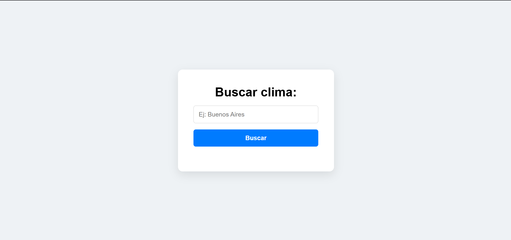
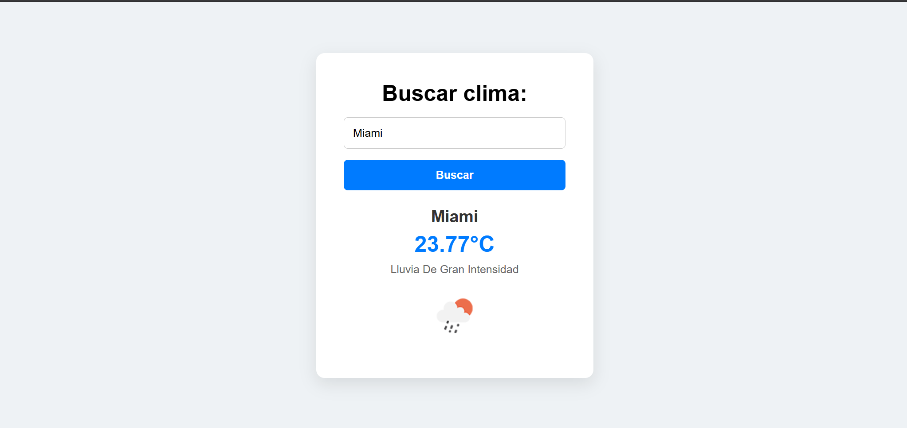

# 🌤️ Weather App (FastAPI + Vanilla JS)

Una aplicación web fullstack para consultar el clima en tiempo real de cualquier ciudad del mundo. El proyecto fue desarrollado enfocado en aprender y aplicar **fundamentos nativos de desarrollo web**, comunicación asíncrona mediante REST APIs y separación limpia entre frontend y backend sin depender de frameworks pesados.

---

## 📸 Vista Previa

<p align="center">
  
  
</p>

---

## 🛠️ Tecnologías Utilizadas

### **Backend**
* **Python 3.x**
* **FastAPI:** Framework web asíncrono para la creación de la API REST.
* **HTTPX:** Cliente HTTP asíncrono para consumir la API externa de OpenWeatherMap.
* **Python-dotenv:** Gestión segura de variables de entorno (API Keys).
* **Uvicorn:** Servidor ASGI para la ejecución del backend.

### **Frontend**
* **HTML5:** Estructura semántica.
* **CSS3:** Maquetación moderna utilizando Flexbox para centrado absoluto y diseño de tarjetas (cards).
* **Vanilla JavaScript (ES6+):** Manipulación directa del DOM, manejo de eventos y peticiones HTTP asíncronas con `fetch` y `async/await`.

---

## ⚡ Características Clave

* **Integración con OpenWeatherMap:** Búsqueda geográfica por nombre de ciudad y código de país (ej. `Mendoza`, `La Paz, AR`).
* **Manejo de CORS:** Configuración adecuada de `CORSMiddleware` para permitir la comunicación segura entre el servidor local y el cliente.
* **Tratamiento de Errores HTTP:** Manejo explícito de respuestas no encontradas (404) y errores de conexión tanto en FastAPI como en el frontend.
* **Variables de Entorno:** Protección de credenciales sensibles mediante `.env` excluded del control de versiones.

---

## 🚀 Instalación y Uso Local

### **1. Clonar el repositorio**
```bash
git clone https://github.com/IvanTuama98/weather-app-fastapi.git
cd weather-app-fastapi
```

### **2. Configurar el Backend**
Crea un entorno virtual e instala las dependencias:

```bash
python -m venv venv
```
# En Windows:
```bash
venv\Scripts\activate
```
# En Mac/Linux:
```bash
source venv/bin/activate

pip install -r requirements.txt
```

Crea un archivo .env en la raíz con tu clave de OpenWeatherMap:

```bash
OPENWEATHER_API_KEY=tu_api_key_aqui
```

Ejecuta el servidor con Uvicorn:

```bash
uvicorn main:app --reload
```

El servidor estará corriendo en `http://127.0.0.1:8000`.

### **3. Ejecutar el Frontend**
Abre el archivo frontend/index.html en tu navegador (o utiliza la extensión Live Server en VS Code).
